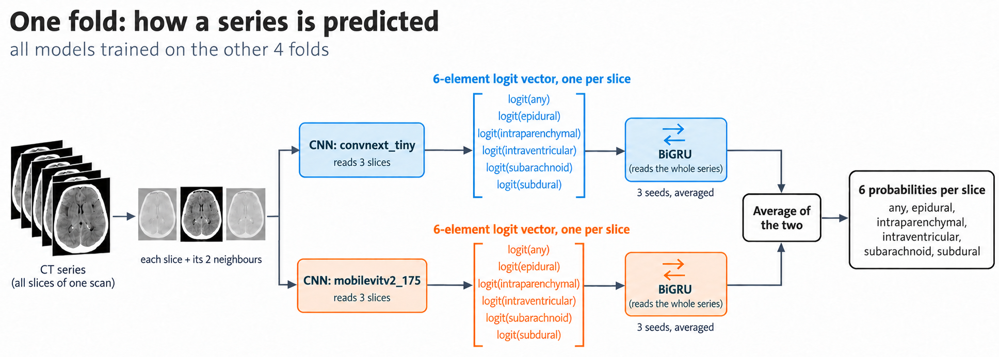

# RSNA Intracranial Hemorrhage Detection

An end-to-end pipeline for the [RSNA Intracranial Hemorrhage Detection](https://www.kaggle.com/competitions/rsna-intracranial-hemorrhage-detection) challenge (Kaggle, 2019): find acute bleeding inside the skull, and its five subtypes, on every slice of a head CT. The project rebuilds a solution from scratch after the competition and scores it with late submissions.

The notebooks are meant to be read in order. Each one answers a few questions, shows the work, and ends with its key findings and a short summary.

## Results

Private leaderboard, late submissions:

| Submission | Private score | Notebook |
|---|---:|---|
| CNNs alone: ensemble of 2 backbones × 5 folds | 0.04781 | 06 |
| convnext_tiny with its BiGRU (5 folds) | 0.04577 | 06 |
| mobilevitv2_175 with its BiGRU (5 folds) | 0.04572 | 06 |
| Both backbones with their BiGRUs | 0.04452 | 05, 06 |
| **The same, temperature from each model's training folds (final)** | **0.04441** | 05 |

For scale, the final leaderboard of 2019: 1st 0.04383, 2nd 0.04484, 10th 0.04712, 50th 0.05473. The final file lies between the 1st and the 2nd place. These are late submissions, not ranks in the competition.

Out of fold (5 folds, labels of their position; notebook 03 explains the setup):

| Model | Score |
|---|---:|
| CNN alone: convnext_tiny / mobilevitv2_175 | 0.0641 / 0.0624 |
| CNN + BiGRU: convnext_tiny / mobilevitv2_175 | 0.0635 / 0.0599 |
| Both backbones with their BiGRUs | 0.0586 [0.0569, 0.0603] |

## Notebooks

| # | Notebook | Question |
|---|---|---|
| 00 | [Project overview](notebooks/00_overview.ipynb) | What is the task, the metric and the data? |
| 01 | [Exploratory data analysis](notebooks/01_eda.ipynb) | What is in the labels, the DICOM headers and the pixels, and what must be fixed? |
| 02 | [Data preparation](notebooks/02_data_preparation.ipynb) | How are the slices ordered, de-duplicated, split into folds and stored? |
| 03 | [Metric and baselines](notebooks/03_metric_and_baselines.ipynb) | How is the metric computed, how precise is the validation, and what does a model without images score? |
| 04 | [Slice models](notebooks/04_slice_models.ipynb) | Which input, window, crop, resolution and backbone for a CNN on one slice and its neighbours? |
| 05 | [Sequence models](notebooks/05_sequence_models.ipynb) | How much does a model over the whole series add, and how is it trained without seeing the validation fold? |
| 06 | [Ensembling](notebooks/06_ensembling.ipynb) | Does an ensemble of the models of 04 and 05 beat the BiGRU, and what does each step score on the test set? |

The pipeline in short:
- **Slice model (04):** a CNN reads a slice with its two neighbours in the subdural window, cropped to the head, at 512 px, and outputs six probabilities. Two backbones, convnext_tiny and mobilevitv2_175, each trained on five folds split by patient.
- **Sequence model (05):** a 2-layer BiGRU reads the six logits of every slice of a series and corrects each slice. It is trained on its CNN's outputs on that CNN's own four training folds, so neither sees the validation fold.
- **Ensemble (06):** the mean of the 2 backbones × 5 folds × 3 seeds = 30 BiGRUs.



## Compared with the top solutions

Shared with most of the top 10:
- a 2D CNN on adjacent slices in fixed windows at about 512 px, as the 3rd place (three slices in the subdural window);
- a sequence model over the series; a BiGRU as in the 1st and 7th place;
- folds split by patient and a loss weighted like the metric.

Where the gap is:
- **Fewer and smaller CNNs.** Most top teams averaged many CNNs (up to 18), often larger ones; this project trains two small backbones.
- **One input pipeline.** The 1st place combined three (one slice in three windows, three slices in one window, both). Here a second pipeline, one slice instead of three, was the best addition on fold 0 (−0.0016, notebook 06), but it was not trained on all five folds.
- **The sequence model reads only the logits.** The 1st and 2nd place fed the CNN's feature vector too; here the vector did not help (05).

## Project structure

```
notebooks/        the numbered notebooks; figures/ holds their diagrams
src/ich/          the package: data (DICOM, slice table, crops, datasets), models, metric, submission, training
scripts/          data preparation, training and prediction (the notebooks read their outputs)
tests/            unit tests of the package
configs/          paths.yaml: where the data, models and outputs live
models/           trained weights (not tracked)
outputs/          runs, features, sequence runs and submissions (not tracked)
```

## Setup

Python 3.11. Install PyTorch first, built for your CUDA version (developed with PyTorch 2.14 on an RTX 5090, 32 GB), then:

```bash
pip install -r requirements.txt
pip install -e .
```

The competition data (about 460 GB unpacked) is not included. Download it from the [competition page](https://www.kaggle.com/competitions/rsna-intracranial-hemorrhage-detection/data), for example with the Kaggle CLI:

```bash
kaggle competitions download -c rsna-intracranial-hemorrhage-detection
```

Unpack it to `../data/raw/rsna-intracranial-hemorrhage-detection` next to the repository, or put other locations in `configs/paths.local.yaml` (same keys as `configs/paths.yaml`, not tracked). The prepared images need about 200 GB more on a fast disk.

## Reproducing

Data preparation (notebooks 01–02):

```bash
python scripts/extract_dicom_headers.py
python scripts/prepare_data.py
python scripts/build_crop_store.py --boxes slice256
```

The final models, for each fold `k` in 0–4 (notebooks 04–05). The fold-0 slice models are named `b3_512_convnext_tiny` and `b3_512_mobilevitv2_175` instead of `c_..._f0`, as the notebooks read them under these names:

```bash
python scripts/train_slice.py --name c_convnext_tiny_fk --backbone convnext_tiny.fb_in22k_ft_in1k --fold k --slices 3 --windows subdural --crop slice256 --size 512 --train-share 1.0 --accumulate 3 --jitter --embeddings
python scripts/train_slice.py --name c_mobilevitv2_175_fk --backbone mobilevitv2_175.cvnets_in22k_ft_in1k --fold k --slices 3 --windows subdural --crop slice256 --size 512 --train-share 1.0 --accumulate 6 --jitter --embeddings
python scripts/extract_features.py --name c_convnext_tiny_fk
python scripts/extract_features.py --name c_mobilevitv2_175_fk
python scripts/train_sequence.py --name is_cx_logits_fk_s0 --cnn c_convnext_tiny_fk --source insample --inputs logits --seed 0
python scripts/train_sequence.py --name is_mv_logits_fk_s0 --cnn c_mobilevitv2_175_fk --source insample --inputs logits --seed 0
python scripts/fit_temperature.py --name is_cx_logits_fk
python scripts/fit_temperature.py --name is_mv_logits_fk
```

The sequence models are trained with seeds 0, 1 and 2. On one RTX 5090 the slice models and their features take about a day for all five folds, the sequence models a few hours. Notebook 05 writes the final submission (`outputs/submissions/05_seq10_bigru_T.csv.gz`); notebook 06 writes the files of its comparison.

The notebooks train nothing: they read the saved runs. Notebooks 04–06 also read the screening runs on fold 0; the settings of every run are in `outputs/runs/RUN/config.json` and `outputs/seq_runs/RUN/config.json`.

## Tests

```bash
pytest
```

## License

The code is under the [MIT License](LICENSE). The competition data belongs to RSNA and is not included; see the competition's rules on Kaggle.

## Use of AI tools

Large language models (Claude Opus 5.5, GPT-6 Astra, DeepSeek V4.1 Flash, Gemini 3.8 Flash and others) were consulted during this project, and part of the code was written by them. All code and outputs were checked by the author, who takes full responsibility for them.
